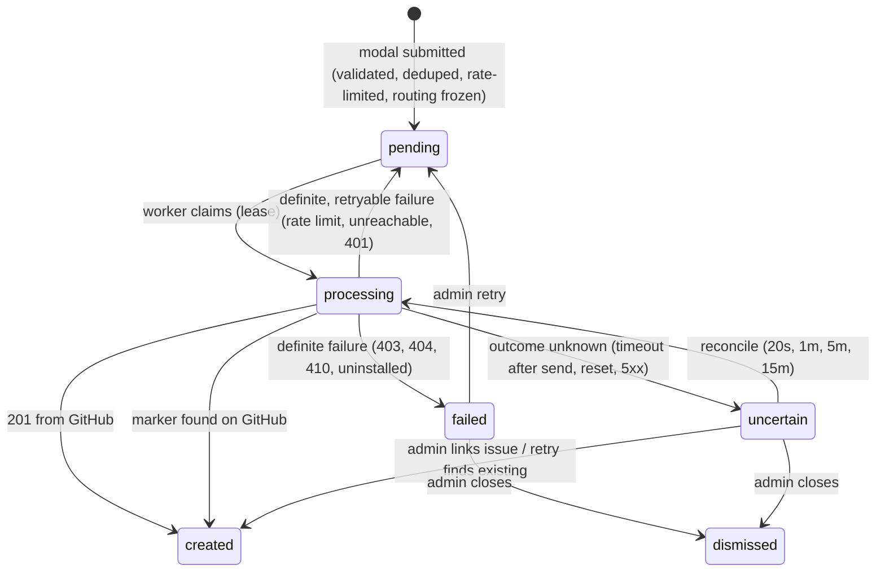

# Ticket Relay

Discord-native support tickets, filed as GitHub issues.

Members open tickets from a panel in your Discord server. Each ticket is routed to the GitHub
repository of the app it concerns and filed as an issue by a GitHub App. Reporters never need a
GitHub account. Integrations, routing and ticket history are managed from a web admin console.

**Stack:** Node.js 24 · TypeScript · Fastify · PostgreSQL · Discord HTTP Interactions · GitHub Apps

---

## Contents

- [Features](#features)
- [Architecture](#architecture)
- [Ticket lifecycle](#ticket-lifecycle)
- [Quick start](#quick-start)
- [Configuration](#configuration)
- [HTTP endpoints](#http-endpoints)
- [Data model](#data-model)
- [Security](#security)
- [Development](#development)
- [Deployment](#deployment)
- [Scope](#scope)

## Features

### For members (Discord)

| Feature | Details |
|---|---|
| Ticket panel | Persistent message in a designated channel with an app picker. With more than 25 apps, the menu shows 24 plus "More apps…", which opens a private, paginated picker. |
| Ticket form | Native Discord modal: title (3–200 chars) and description (10–4000 chars), with guidance for repro steps and expected vs. actual behavior. |
| Visibility notice | The form states whether the target repository is public or private, and warns against submitting secrets. |
| Private confirmation | Ephemeral reply with app, issue number, reference ID (`TR-XXXXXXXXXX`) and link. Updated in place as the ticket moves from queued to filed. |
| No GitHub account | The issue is created by the GitHub App and credited to the member's Discord identity. |
| Safeguards | Per-user rate limit, duplicate-submission detection, and text echoed back when a submission can't be accepted. |

### For admins (web console)

| Area | Capabilities |
|---|---|
| GitHub | Install or link the GitHub App, verify installation ownership, list accessible repositories, Issues status, visibility and app usage. |
| Discord | Add the bot via OAuth, pick a manageable server, choose the tickets channel. Shows the bot's effective permissions per channel. |
| Apps | Create, edit, enable/disable, reorder and remove apps. Map each app to a repository and optional existing labels. Several apps can share one repository. |
| Validate & publish | Live checks (installation, repo access, Issues enabled, archived repos, labels, bot membership, channel permissions, panel state), panel and form preview, publish/update/move panel, explicit test ticket. |
| Submissions | Filterable, searchable history: status, reporter, app and issue link. Per-ticket timeline, error codes, and resolve actions (re-check, retry, link existing issue, close). |
| Settings | Rate limit, duplicate window, text retention, panel copy. |
| Access | Owner/admin roles, one-time invite links, member removal. |
| Deployment status | Lists missing provider configuration and the exact callback/endpoint URLs to register. |

## Architecture

A single long-running Node.js service backed by PostgreSQL. It serves three roles from one
process:

```
                ┌───────────────────────────── ticket-relay ─────────────────────────────┐
 Discord ──────▶│ POST /discord/interactions   verify Ed25519 → accept → ack (≤3s)       │
                │                                       │                                 │
 Admins ───────▶│ Admin console (SSR, sessions, CSRF)   ▼                                 │
                │                               submissions (queue) ◀── worker ──────────┼──▶ GitHub REST
 GitHub ───────▶│ POST /github/webhook (optional)       │            create / retry /     │    (installation token)
                │                                       │            reconcile            │
                └───────────────────────────────────────┼─────────────────────────────────┘
                                                         ▼
                                                    PostgreSQL
```

- **No Discord gateway.** The bot is driven entirely by Discord's HTTP interactions endpoint and
  REST API. It needs no privileged intents and no slash-command registration.
- **GitHub App auth.** Short-lived installation tokens are minted from the app's private key
  (RS256 JWT). Required permissions: `Issues: read & write`, `Metadata: read`.
- **Postgres-backed queue.** Submissions are the jobs. Workers claim them with
  `FOR UPDATE SKIP LOCKED` and a 90s lease, so any number of instances can run concurrently.
- **Server-rendered admin UI.** No frontend build. A small progressive-enhancement script, a
  strict CSP, and no credentials in the browser.

### Tenancy

- All data is scoped to a **workspace**: one GitHub App installation and one Discord server.
- A Discord server maps to exactly one workspace, because interactions are routed by `guild_id`.
  This is enforced by a unique constraint.
- Admins authenticate with Discord OAuth and hold an `owner` or `admin` role per workspace.
  Non-members receive 404 on workspace routes.
- Workspace creation is limited to `PLATFORM_ADMIN_DISCORD_IDS`. If that list is empty, only the
  first user of a fresh deployment can create one. `OPEN_WORKSPACE_CREATION=true` lifts the limit.

## Ticket lifecycle



| Guarantee | Mechanism |
|---|---|
| Discord 3s deadline | Validation and persistence in one short transaction, then a deferred ephemeral response. GitHub work starts after the response is flushed. |
| Redelivery safety | `discord_interaction_id` is unique, so a repeated interaction is processed once. |
| Accidental duplicates | Keyed HMAC of normalized title and description per reporter and app, within a configurable window. |
| Concurrency | Per-reporter advisory lock during accept. `SKIP LOCKED` and leases during processing. Writes are guarded by lease owner. |
| No blind retries | `github_request_started_at` is persisted before the create call. Unknown outcomes and crashed workers are reconciled by searching for the hidden marker `<!-- ticket-relay:submission=TR-… -->`, never by re-sending. |
| Stable routing | Repository, labels and installation are snapshotted at acceptance. Config changes never redirect queued tickets. |
| Label integrity | Labels are checked against the repository before creating, so GitHub never auto-creates them. A `422` triggers one retry without labels. |
| Retention | The description is dropped once the issue exists. Titles are purged after the workspace retention period (default 30d). Unresolved tickets keep their text for at least 90d. |

### Issue format

```
Title:  [App Name] Submitted title

### Description
<member's text, GitHub @-mentions neutralized>

### Ticket details
| App | Reported by | Submitted | Discord server | Submitted from channel | Submission ID |

<sub>Submitted through Discord by <member> and created by the Ticket Relay integration…</sub>
<!-- ticket-relay:submission=TR-7KQ2M9XA4D -->
```

The issue author is `<app-slug>[bot]`. The reporter's Discord display name, username and
stable user ID are recorded in the body.

## Quick start

**Requirements:** Node.js ≥ 22, PostgreSQL ≥ 13.

```bash
npm install
cp .env.example .env        # set DATABASE_URL, PUBLIC_URL, ENCRYPTION_KEY
npm run dev                 # http://localhost:3000, migrations run on start
```

For local UI work without Discord credentials, set `DEV_LOGIN=true`. It only works with a
localhost `PUBLIC_URL` and is always disabled in production. To receive real interactions
locally, expose the port through an HTTPS tunnel and use that URL as `PUBLIC_URL`.

Provider registration (one-time): [`docs/PROVIDER_SETUP.md`](docs/PROVIDER_SETUP.md)

## Configuration

Environment variables hold deployment secrets only. All operational configuration (connections,
channels, apps, labels, limits) lives in the database and is managed from the console.

| Variable | Required | Description |
|---|---|---|
| `DATABASE_URL` | yes | PostgreSQL connection string |
| `PUBLIC_URL` | yes | Public HTTPS origin, used for OAuth callbacks and secure cookies |
| `ENCRYPTION_KEY` | yes | 32 bytes, base64 (`openssl rand -base64 32`). AES-256-GCM for stored tokens and ticket text. Must stay stable. |
| `DISCORD_APPLICATION_ID` | yes¹ | Discord application ID |
| `DISCORD_PUBLIC_KEY` | yes¹ | Interaction signature verification key |
| `DISCORD_CLIENT_SECRET` | yes¹ | OAuth2 (admin sign-in, bot install) |
| `DISCORD_BOT_TOKEN` | yes¹ | Bot REST calls (panel, guild inspection) |
| `GITHUB_APP_ID` | yes¹ | GitHub App ID |
| `GITHUB_APP_SLUG` | yes¹ | App URL slug, used to build the install URL |
| `GITHUB_CLIENT_ID` | yes¹ | GitHub App client ID (JWT issuer, OAuth) |
| `GITHUB_CLIENT_SECRET` | yes¹ | Installation-ownership verification |
| `GITHUB_APP_PRIVATE_KEY` | yes¹ | PEM (`\n`-escaped or base64). Alternatively `GITHUB_APP_PRIVATE_KEY_FILE`. |
| `GITHUB_WEBHOOK_SECRET` | no | Enables `/github/webhook` for uninstall/suspend events |
| `PLATFORM_ADMIN_DISCORD_IDS` | no | Comma-separated Discord user IDs allowed to create workspaces |
| `OPEN_WORKSPACE_CREATION` | no | `true` lets any signed-in user create a workspace |
| `RUN_WORKER` | no | `false` disables the in-process worker (default `true`) |
| `AUTO_MIGRATE` | no | `false` skips migrations on boot (default `true`) |
| `TRUST_PROXY` | no | `true` behind a reverse proxy or load balancer |
| `PORT` / `HOST` / `LOG_LEVEL` | no | Defaults: `3000` / `0.0.0.0` / `info` |

¹ The service boots without provider credentials. The affected features are disabled, and the
console lists what is missing.

## HTTP endpoints

| Route | Caller | Auth |
|---|---|---|
| `POST /discord/interactions` | Discord | Ed25519 signature, 5-minute timestamp window |
| `GET /oauth/discord/callback` | Browser | One-time state, bound to session (bot install) or nonce cookie (sign-in) |
| `GET /oauth/github/callback` | Browser | One-time state. Installation verified via `GET /user/installations`. |
| `POST /github/webhook` | GitHub | HMAC-SHA256 (`X-Hub-Signature-256`). 404 when no secret is configured. |
| `GET /healthz` | Load balancer | none (DB ping) |
| `/w/:workspaceId/*` | Admins | Session cookie, workspace membership, CSRF on POST |

## Data model

| Table | Purpose |
|---|---|
| `workspaces` | Tenant root, with rate-limit, duplicate-window, retention and panel-copy settings |
| `users`, `workspace_members`, `workspace_invites` | Admin identities (Discord), roles, one-time invites |
| `sessions`, `oauth_states` | Hashed session tokens with CSRF token, and single-use OAuth state |
| `github_connections` | Installation ID, account and status per workspace |
| `discord_connections` | Guild (globally unique), tickets channel and status per workspace |
| `apps` | Member-facing name/description → repository ID and labels |
| `panels` | Published panel message ID, channel and content hash (detects stale or deleted panels) |
| `submissions` | Tickets, routing snapshot, queue state, lease, reconcile counters, encrypted payload |
| `submission_events` | Append-only timeline for investigation |

Migrations live in [`src/db/migrations`](src/db/migrations) and are applied under an advisory
lock, so concurrent boots are safe.

## Security

- **Secrets:** server-side only. Provider credentials come from env. Stored tokens and ticket
  text are encrypted at rest. Session tokens are stored hashed.
- **Inbound verification:** Discord Ed25519 signatures, GitHub webhook HMAC, single-use OAuth
  state bound to the browser session.
- **Ownership checks:** the Discord guild is taken from the OAuth token response, not redirect
  parameters. The GitHub installation must appear in the authorizing user's installations.
- **Server-side allowlists:** repositories are restricted to the workspace installation (Issues
  enabled, not archived). Labels must exist. Channels must belong to the connected guild and
  pass a permission check.
- **Output safety:** `allowed_mentions: { parse: [] }` on all Discord messages, Discord
  markdown escaped in echoes, GitHub @-mentions neutralized in issue bodies.
- **Web hardening:** strict CSP with no inline script or style, `frame-ancestors 'none'`,
  `Referrer-Policy: same-origin`, `SameSite=Lax` and `HttpOnly` cookies (`Secure` on HTTPS).
- **Logging:** structured JSON. Query strings, auth headers and cookies are stripped, and
  ticket text is never logged.
- **Error exposure:** members see generic messages. Provider error details are shown only to
  workspace admins.

## Development

| Command | Description |
|---|---|
| `npm run dev` | Watch mode (web + worker) |
| `npm run build` | Compile to `dist/` and copy migrations and static assets |
| `npm start` | Run the compiled service |
| `npm run start:worker` | Worker-only process |
| `npm run migrate` | Apply migrations (`migrate:prod` for compiled builds) |
| `npm run typecheck` | Type-check source and tests |
| `npm test` | Run the test suite |

### Testing

```bash
TEST_DATABASE_URL=postgres://localhost:5432/ticket_relay_test npm test
```

The suite runs the real service (routes, database, worker, provider REST clients) against
in-memory fakes of the GitHub and Discord APIs ([`test/fakes.ts`](test/fakes.ts)). Coverage
includes:

- workspace isolation, CSRF and role checks
- OAuth state, spoofed installation IDs and guild ownership
- signature verification, the repository and channel allowlists, and channel permissions
- interaction redelivery, concurrent duplicate submissions and rate limiting
- every GitHub failure class, timeout reconciliation and crashed-worker recovery
- multi-worker concurrency, restarts, and panel publish/update/recreate/move

### Project structure

```
src/
├── index.ts / worker.ts     entry points (combined service, worker-only)
├── app.ts                   dependency wiring
├── config.ts                env parsing and validation
├── db/                      pool, migration runner, SQL migrations
├── discord/                 REST client, signature verification, permission math,
│                            payload builders, interaction handler
├── github/                  GitHub App client (JWT, installation tokens), issue rendering
├── domain/                  accept/queue, processor (create · classify · reconcile),
│                            worker, panel, validation, persistence
└── web/                     Fastify server, sessions/CSRF, layout, routes, static assets
test/                        integration and unit tests, provider fakes
docs/                        provider setup, deployment
```

## Deployment

Ticket Relay needs a **long-running process** with a public HTTPS URL: an always-on HTTP
endpoint, a background worker and post-response work. Serverless platforms (Vercel, Netlify
Functions, Lambda) are not supported. Container hosts such as Railway, Render, Fly.io, ECS or
Kubernetes work out of the box using the included `Dockerfile`.

```bash
docker compose up --build   # service + PostgreSQL
```

Horizontal scaling: run any number of instances against the same database. Optionally run web
instances with `RUN_WORKER=false` and scale `npm run start:worker` separately.

Full runtime, scaling, retention and operations guide: [`docs/DEPLOYMENT.md`](docs/DEPLOYMENT.md)

## Scope

**Included:** ticket submission from Discord, routing to GitHub issues, admin console,
reliability and audit trail.

**Not included:** comment sync between GitHub and Discord, issue-status sync, attachments,
private per-ticket Discord channels.
