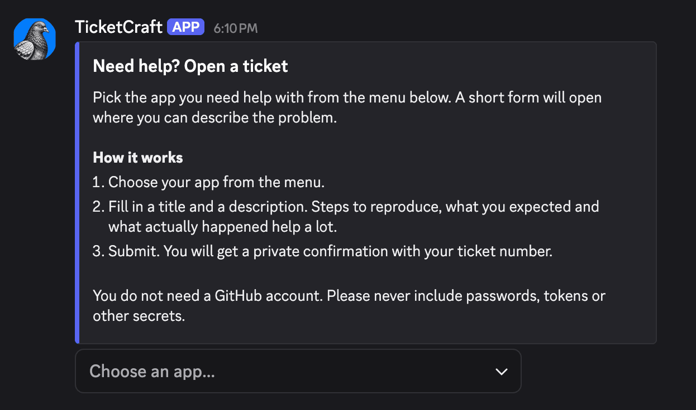
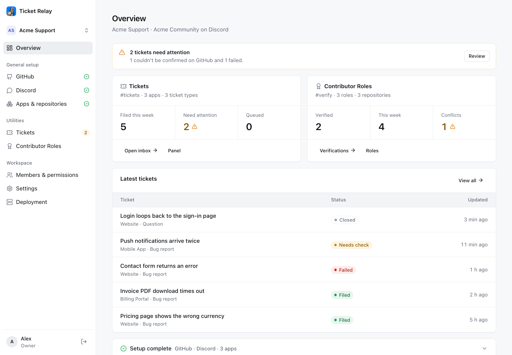

<p align="center">
  
</p>

<h1 align="center">Ticket Relay</h1>

<p align="center">
  Discord support tickets, filed as GitHub issues.<br>
  <code>Node.js 24</code> · <code>TypeScript</code> · <code>Fastify</code> · <code>SQLite</code> · <code>Discord Interactions</code> · <code>GitHub Apps</code>
</p>

Members submit tickets from a panel in Discord. Each ticket is routed to the right repository
and filed by a GitHub App. Reporters never need a GitHub account.

<p align="center">
  
</p>

## Features

**Discord tickets**

- **Discord-native:** members open tickets from a panel in your server and get a private confirmation with the issue link. No GitHub account needed.
- **Ticket types and forms:** members pick a type (e.g. Bug report, Feature request); each adds its GitHub label and a `[Bug]` title prefix. Each type has its own Discord form with short-answer, paragraph and file-upload questions; answers appear as headings in the issue.
- **Screenshots:** members attach PNG or JPG images (up to 10 MB per ticket). They're stored on your server with location data removed and embedded in the issue.
- **Inbox:** every ticket with its status, triage and GitHub link; retry, link an existing issue or close, with search and filters.
- **Spam and duplicates:** a per-member rate limit and duplicate window; a ticket is never filed twice, even when GitHub's reply is unclear.
- **Files:** see what's stored, clean up files of closed or spam tickets by rule (or automatically once a day), and set a storage limit.

**Tools**

- **GitHub issues:** search every issue, open and closed, across your connected repositories, including the ones opened directly on GitHub. Kept up to date every 2 minutes, no webhooks needed.
- **Repo status (optional):** every repository at a glance, like a team status board: open PRs and issues and the oldest open PR, the last commit, issue and PR, what happened in a window you pick (10 minutes to a week, since the last build, or all time: commits, PRs opened and merged, issues, people), and each latest build with its unreleased commits and downloads. Sort by any column; a totals row sums them up. Fix first ranks the open issues across the repositories by what they say (crash, hang, data loss beats "doesn't work"), who filed them, how many people pile on and how fresh they are, with the reasons beside each score. Most reported ranks the issues by how many Discord tickets are about them (a duplicate counts for its original; ones Claude suggested and nobody has reviewed yet are shown as waiting for review), over the last 7, 30 or 90 days or all time, with the tickets one click away, and says when an issue closed as fixed keeps being reported. Pull requests lists the open ones (the ones fixing the most reported issues first, with how many Discord tickets are about them), the merged ones waiting for a release, and the ones merged in the last 90 days; Fix first and Most reported show when someone's working on an issue or it's already fixed. Read in the background every 5 to 60 minutes with GitHub's GraphQL API, which has its own budget, so filing isn't affected. Off until you turn it on; you pick the repositories (your apps' ones to start with).
- **Analytics (optional):** downloads recorded every 30 minutes from when you turn it on (GitHub only keeps running totals), per app, platform, processor, format and version, from 30 minutes to 12 months at a time (today in 30-minute steps by default; steps of 30m, 1h, 3h, 6h, 12h or a day), in your own time zone, or All: lifetime totals (GitHub's own download and star counts) with the same breakdowns. The main chart switches between downloads and stars: stars gained over time (the change in GitHub's star count, read every 30 minutes with the downloads from when you turn it on; a star taken back counts -1) and each app's star total. Next to them: tickets, issues opened and closed, pull requests merged and stars over the same time, each compared with the period before, and release health: Discord tickets while each release was the latest, per 1,000 of its downloads. Every chart has a table view.
- **AI triage (optional):** Claude flags priority, duplicates, regressions, spam and more, and sorts tickets with your own label groups. Each action can be off, a suggestion, or automatic above a confidence threshold, with separate settings for issues opened directly on GitHub.
  - AI triage › Review lists everything with suggestions waiting, from Discord tickets and GitHub issues. Every ticket shows its triage state (To review, Partly applied, Applied…), and suggestions say exactly what applying them does.
  - Apply or dismiss in bulk, e.g. all duplicates at 80%+ confidence.
  - AI triage › Knowledge: Claude writes a TRIAGE.md for each app from its repository (README, changelog, docs, releases) and its issues, open and closed (known issues, recent fixes, what works as intended, common questions), and reads it with every ticket for that app. It can keep them up to date: you pick one interval (15 minutes to 90 days), and each time it comes around Claude updates the apps where something changed (issues opened or closed, merged pull requests, releases, its own questions) and skips the rest. What's merged into each repository (pull requests, commits pushed without one, releases; bots and chores left out) is checked every 15 minutes: tickets get the latest changes right away, Claude adds them to the TRIAGE.md without rewriting the rest, and each app's page lists them with what Claude added and what it left out. While it writes, a Live studio shows each app's TRIAGE.md appearing, with a log of what Claude read and the questions it answered, and lets you stop or skip; minimized, a small pill follows you to every page. Your team can add notes on top, which Claude never changes.
  - When a fact would have made Claude surer, it asks. It answers its own questions from the repository when it can. Each app's page has tabs after its TRIAGE.md (All, Needs your team, Claude will look, Answered) listing the questions day by day under the ticket each came from; your team answers right there, and Claude reads those answers with every ticket for that app. Questions are for the team only.
  - Being worked on and Already fixed (off by default): Claude also compares each ticket with the repository's open pull requests and the ones merged in the last 90 days, including the ones that say which issue they're for ("for #3592"). A ticket an open pull request works on gets your label and comment ("This is being worked on in #3597."), next to the duplicate when it's one; a ticket a merged pull request (or a commit pushed without one) already fixed says whether that's in a release yet ("it's in v1.4.3", "it will be in the next release"). A fix that didn't hold stays a Regression. Pull requests are read from GitHub's pull request list every 10 minutes (usually one call per repository); a public repository's need no extra permission, a private one's need Pull requests: Read.
  - Optionally, Claude also looks at the screenshots members attach (off by default).
  - Re-run triage on older tickets and compare settings before applying anything.
  - AI triage › Activity shows what it's doing live, with a log kept 90 days.
  - It runs in its own worker with a monthly limit and keeps GitHub API headroom for filing, so filing never depends on it.
  - If Claude stops (out of credits, a rejected key, the monthly limit), every page shows an alert until it's fixed. Out of credits, it checks again every 5 minutes and carries on by itself.
- **Announcements (optional):** each app's new GitHub releases posted in a Discord channel. Claude rewrites the release notes for the people using the app (or they're posted as written on GitHub), and you can edit them before they go out. Review first keeps new releases waiting under Posts until someone posts them; Automatic posts them as soon as the notes are written. The message, its title and text are templates. The buttons under it are your own: each has a label and a link, which can be any web address, the release on GitHub, or one of the release's files found by name (`{file:*-windows-x64.msi}`), for every app or one; a release without that file just doesn't get the button, and Settings shows what each link finds in the latest release. The release notes button can be renamed or turned off. Pre-releases are left out unless you include them; each app can have its own channel. Pings are off until you choose a role (one for every app, or an app's own, or none), and a "Get update pings" message lets members give themselves the role and drop it again. Releases are checked every 5 minutes with GitHub's GraphQL API; you can also announce an older release by hand, edit or delete a post afterwards, and send a test post. Off until you turn it on; only releases published after that are announced.
- **Contributor roles:** a second panel where members sign in with GitHub and get a role based on their merged PRs or commits across all your apps, e.g. Junior Contributor at 1, Contributor at 10. Merged PRs are counted from the pull requests the app keeps (read again just before each check, so one merged a moment ago counts), which works for public repositories without the Pull requests permission.
- **Server health:** processes, memory, disk, queues, GitHub API usage and alerts, with a Dev mode so restarts while you deploy aren't counted as crashes.

**Team**

- **Roles:** owners, admins and moderators; several workspaces on one install.
- **Moderators:** start with the tickets inbox and contributor verifications, view only. Admins give each one no access, view or edit on every page of every tool (tickets, issues, AI triage, contributor roles, Apps & repositories, server health), a whole tool at once or page by page.

**Reliable and secure**

- Duplicate and rate-limit protection, retries, and queues that survive restarts.
- Credentials stay on the server; stored tokens, the Claude key and ticket text are encrypted.

## Screenshots

**Overview:** tickets needing attention, stats for each tool and the latest tickets.



## Quick start

```bash
npm install
cp .env.example .env    # PUBLIC_URL, ENCRYPTION_KEY
npm run dev             # http://localhost:3000
```

Set `DEV_LOGIN=true` to use the console locally without Discord credentials.

## Self-hosting

One host, PM2 and a TLS reverse proxy. No external database: state is a single SQLite file.
Serverless platforms such as Vercel are not supported.

```bash
npm ci && npm run build
cp .env.example .env               # PUBLIC_URL, ENCRYPTION_KEY, provider credentials
pm2 start ecosystem.config.cjs     # web (1) + queue workers (2) + triage (1); migrations run on boot
pm2 save && pm2 startup
```

Then:

1. Proxy HTTPS to port `3000` (set `HOST=127.0.0.1` so the port isn't public).
2. Register the Discord application and the GitHub App: [docs/PROVIDER_SETUP.md](docs/PROVIDER_SETUP.md).
3. Open `PUBLIC_URL`, sign in with Discord and follow the setup steps.

Processes, operations, backups and scaling: [docs/DEPLOYMENT.md](docs/DEPLOYMENT.md).

## Configuration

| Variable | Description |
|---|---|
| `DATABASE_PATH` | SQLite file (default `./data/ticket-relay.db`) |
| `FILES_DIR` | Files attached to tickets (default `./data/files`, next to the database) |
| `PUBLIC_URL` | Public HTTPS origin |
| `ENCRYPTION_KEY` | `openssl rand -base64 32`; keep it stable |
| `DISCORD_*` | `APPLICATION_ID`, `PUBLIC_KEY`, `CLIENT_SECRET`, `BOT_TOKEN` |
| `GITHUB_*` | `APP_ID`, `APP_SLUG`, `CLIENT_ID`, `CLIENT_SECRET`, optional `WEBHOOK_SECRET` |
| `GITHUB_APP_PRIVATE_KEY_FILE` | `./secrets/sec.pem` (git-ignored; see [`secrets/`](secrets/README.md)) |
| `PLATFORM_ADMIN_DISCORD_IDS` | Discord user IDs allowed to create workspaces |
| `ANTHROPIC_API_KEY` | Optional fallback Claude key for AI triage; workspaces normally add their own in Settings |

Optional variables are listed in [`.env.example`](.env.example). Everything else is configured
in the console.

## Scripts

| Command | |
|---|---|
| `npm run dev` | Dev server with reload |
| `npm run build` · `npm start` | Production build and run |
| `npm run start:worker` | Queue worker process |
| `npm run start:triage` | Triage and issue-sync worker |
| `npm run migrate` | Apply migrations (also runs on boot) |
| `npm run typecheck` | Type-check source and tests |
| `npm test` | Test suite (self-contained; uses a temporary SQLite file) |

## Docs

- [Provider setup](docs/PROVIDER_SETUP.md): Discord application and GitHub App registration
- [Deployment](docs/DEPLOYMENT.md): runtime, scaling, retention, operations
- [Architecture](docs/ARCHITECTURE.md): ticket lifecycle, endpoints, schema, security

## Scope

Not included: GitHub ↔ Discord comment sync, status updates to members after filing (the console shows each issue's live state), private ticket channels.
