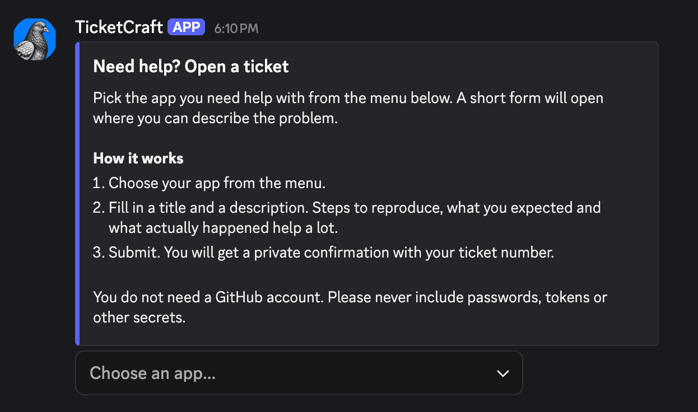
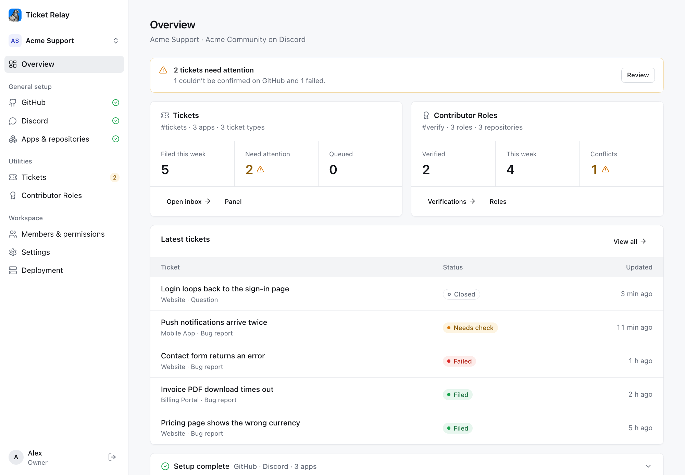

<div align="center">
  
  <h1>Ticket Relay</h1>
  <p><strong>Discord support tickets, filed as GitHub issues.</strong></p>
  <p>
    Members open a ticket from a panel in your Discord server,<br>
    and a GitHub App files it as an issue in the right repository.<br>
    Reporters don't need a GitHub account.
  </p>
  
</div>

## Features

- **Ticket panel:** pick an app and a ticket type, fill in its form, attach screenshots. **My tickets** lets members follow what happens to theirs.
- **Inbox:** every ticket with its status and GitHub link. Retry, link or close. Rate limits and duplicate protection built in.
- **AI triage:** Claude suggests or applies priority, duplicates, labels and spam, using a knowledge file it keeps for each app.
- **Moderation:** close, reply, label and mark duplicates from one queue, with a mod log and undo.
- **Repo status and analytics:** open PRs and issues, the most reported bugs, downloads and stars over time.
- **Discord extras:** announcements, release posts, a known-issues board, contributor roles from merged PRs.
- **MCP:** Claude Code, Cursor, VS Code or Codex can work with tickets.
- **Team:** owners, admins and moderators with access per page. Linked workspaces cover repositories in other GitHub organizations.

Optional features stay off until an admin turns them on.



## Self-hosting

You need a server with a domain, a Discord application and a GitHub App. All state lives in one
SQLite file, so there's no database to run.

### 1. Create the Discord application and GitHub App

Follow [docs/PROVIDER_SETUP.md](docs/PROVIDER_SETUP.md). It takes about 10 minutes. Replace `tickets.example.com` with your domain:

| Setting | Value |
|---|---|
| Discord › General › Interactions Endpoint URL | `https://tickets.example.com/discord/interactions` (set once the app is running) |
| Discord › OAuth2 › Redirect | `https://tickets.example.com/oauth/discord/callback` |
| GitHub App › Callback URL (must be first) | `https://tickets.example.com/oauth/github/callback` |
| GitHub App › Webhook URL (optional) | `https://tickets.example.com/github/webhook` |
| GitHub App › Permissions | Issues: read & write, Metadata: read. Optional: Pull requests and Contents read-only |

### 2. Get the code and configure

```bash
git clone https://github.com/storytold/discord-github-ticket-relay.git
cd discord-github-ticket-relay
cp .env.example .env
```

| Variable | |
|---|---|
| `PUBLIC_URL` | `https://tickets.example.com` |
| `ENCRYPTION_KEY` | `openssl rand -base64 32`. Never change it: it decrypts stored data |
| `DISCORD_*` | `APPLICATION_ID`, `PUBLIC_KEY`, `CLIENT_SECRET`, `BOT_TOKEN` |
| `GITHUB_*` | `APP_ID`, `APP_SLUG`, `CLIENT_ID`, `CLIENT_SECRET`, optional `WEBHOOK_SECRET` |
| `GITHUB_APP_PRIVATE_KEY_FILE` | `./secrets/sec.pem` (the key from the GitHub App page) |
| `PLATFORM_ADMIN_DISCORD_IDS` | Your Discord user ID, so only you can create workspaces |
| `TRUST_PROXY` | `true` behind a reverse proxy |

Everything else is set up in the console. Optional variables are in [`.env.example`](.env.example).

### 3. Run

**Docker:** runs everything in one container. The database and files go in the `/app/data` volume.

```bash
docker run -d --name ticket-relay --restart unless-stopped \
  -p 127.0.0.1:3000:3000 -v ticket-relay-data:/app/data --env-file .env \
  ghcr.io/storytold/discord-github-ticket-relay:latest
```

There's no `secrets/` folder in the container, so pass the key as one line instead: leave
`GITHUB_APP_PRIVATE_KEY_FILE` empty and set `GITHUB_APP_PRIVATE_KEY` to the output of
`base64 -w0 sec.pem`.

**Or Node 22+ with PM2:** runs web, queue workers and triage as separate processes.

```bash
npm ci && npm run build
npm install -g pm2
pm2 start ecosystem.config.cjs && pm2 save && pm2 startup
```

Set `HOST=127.0.0.1` so port 3000 isn't public.

### 4. Add HTTPS

Point your domain at the server and proxy it to port 3000. With Caddy, which gets the certificate by itself:

```
tickets.example.com {
    reverse_proxy 127.0.0.1:3000
}
```

Check it with `curl https://tickets.example.com/healthz`. Then set Discord's Interactions Endpoint URL.

### 5. Sign in

Open your domain and sign in with Discord. Follow the setup steps: GitHub, Discord, then Apps &
repositories. Finally, publish the panel from **Discord tickets › Panel**. The **Deployment** page
shows whether Discord and GitHub are working.

### Updating and backups

| | |
|---|---|
| Update (PM2) | `git pull && npm ci && npm run build && pm2 reload ecosystem.config.cjs` |
| Update (Docker) | `docker pull` the image, then recreate the container |
| Back up | the `data/` folder (database and attached files), with your `.env` |

Migrations run on start. A backup is useless without its `ENCRYPTION_KEY`. Scaling, logs and
online backups are covered in [docs/DEPLOYMENT.md](docs/DEPLOYMENT.md).

## Development

```bash
npm install
cp .env.example .env    # set ENCRYPTION_KEY and DEV_LOGIN=true
npm run dev             # http://localhost:3000
npm test
```

`DEV_LOGIN=true` signs you in without Discord, in development only.

## Docs

- [Provider setup](docs/PROVIDER_SETUP.md): registering the Discord application and GitHub App
- [Deployment](docs/DEPLOYMENT.md): processes, scaling, backups, retention, operations
- [Architecture](docs/ARCHITECTURE.md): ticket lifecycle, endpoints, schema, security

## License

[MIT](LICENSE). Icons are from [Lucide](https://lucide.dev) (ISC).
