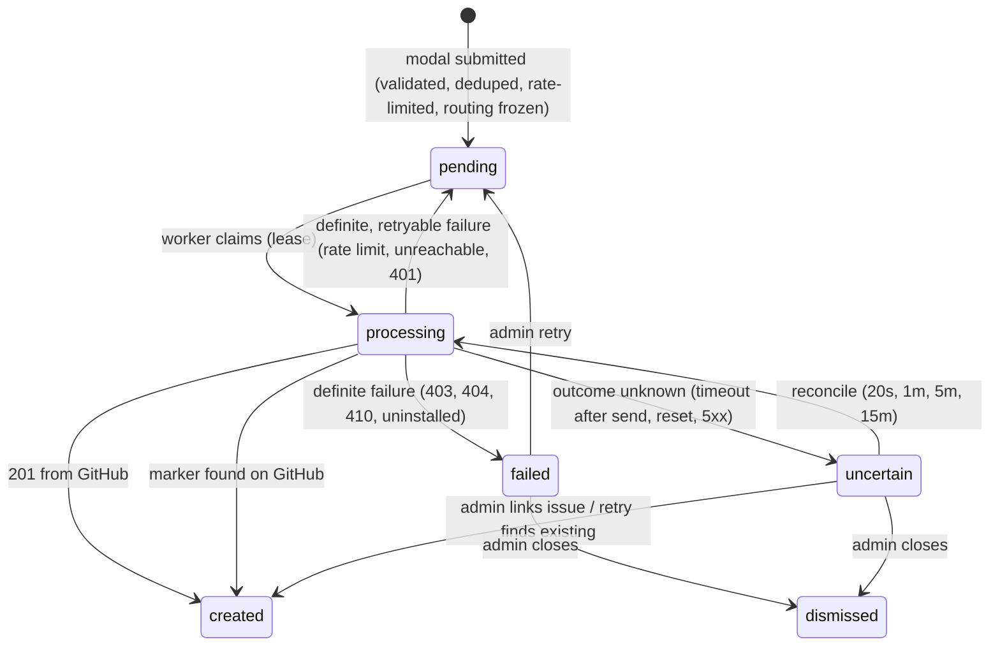

# Architecture

Internals of Ticket Relay: runtime, ticket lifecycle, endpoints, schema and security model.

## Runtime

Long-running Node.js processes sharing one SQLite database: a web process (admin console,
Discord endpoint, OAuth), one or more queue workers, and an optional triage worker.

```
                ┌───────────────────────────── ticket-relay ─────────────────────────────┐
 Discord ──────▶│ POST /discord/interactions   verify Ed25519 → accept → ack (≤3s)       │
                │                                       │                                 │
 Admins ───────▶│ Admin console (SSR, sessions, CSRF)   ▼                                 │
                │                               submissions (queue) ◀── worker ──────────┼──▶ GitHub REST
 GitHub ───────▶│ POST /github/webhook (optional)       │            create / retry /     │    (installation token)
                │                                       │            reconcile            │
                └───────────────────────────────────────┼─────────────────────────────────┘
                                                         ▼
                                                  SQLite (WAL)
```

- **AI triage, isolated from filing.** `src/triage/` runs in its own process. It picks up
  tickets that are already filed (`status = 'created'`, filed after triage was switched on),
  reads the ticket text from the GitHub issue, asks Claude (official SDK, structured JSON
  output) for priority, duplicate, regression, needs-info, several-problems, related,
  shared-across-apps, wrong-repository, spam and no-action calls plus the workspace's own label
  groups, and applies the actions each workspace allows. Results live in `triage_results`; the
  filing queue is never written. Bad keys, missing credits or an unavailable model pause triage
  for that workspace; rate limits and outages retry with backoff. Ticket text is passed as JSON
  data and Claude can only answer with fixed fields; every issue it names is checked against
  what it was shown, and labels, comments and closing come from the workspace settings.
  With its own switch, triage also covers issues opened directly on GitHub: the issue sync
  (polling, no webhooks) queues new ones in `issue_triage`, skipping pull requests, bots and
  issues this app filed. Each action has a separate mode for these issues (`githubModes`);
  labels, comments and closing are shared. Their results are reviewed in GitHub issues › Opened on GitHub and in AI triage › Review.
  Re-runs (`triage_runs`, `triage_run_items`) evaluate already-filed tickets and/or open GitHub issues with a saved copy
  of the settings: a preview never touches GitHub; applying it later (or an "apply" run) writes
  `triage_results` the way normal triage does, in bulk if asked (optionally approving the
  suggestions too). The worker only takes re-run items when no new ticket is waiting, one at a
  time, and a run waits instead of failing when Claude rate-limits it or when the
  installation's GitHub budget drops below a reserve (a fifth of the hourly limit, at least
  500 calls), so filing always has room. Every step is written to `triage_log` (kept 90 days), shown
  live in AI triage › Activity with the queues and what the worker is doing. Bulk Apply from
  the inbox or Opened on GitHub (`triage_bulk`) takes only the suggestions the list's filters are
  about and applies them one ticket at a time, with the same GitHub-budget guard.
  AI triage › Knowledge (`app_knowledge`): the triage worker also writes each app's TRIAGE.md
  with Claude (`src/triage/knowledge-writer.ts`), one app at a time after new tickets and issues,
  from the repository's README, changelog, docs and releases (read-only; private repositories need
  Contents: read) and the app's issues in the issue index (most reported open, recently fixed,
  closed as not planned), plus recent ticket summaries and the questions triage asked
  (`missing_context`, copied to `question`). Each ticket then gets its own app's TRIAGE.md as a
  second cached system block, as background facts (it comes from public text); the team's own
  notes stay separate, are never rewritten, and win. With Keep up to date on, the worker rewrites
  them weekly, and sooner after three new questions.
- **No Discord gateway.** The bot is driven entirely by Discord's HTTP interactions endpoint and
  REST API. It needs no privileged intents and no slash-command registration.
- **GitHub App auth.** Short-lived installation tokens are minted from the app's private key
  (RS256 JWT). Required permissions: `Issues: read & write`, `Metadata: read`; contributor roles add `Pull requests: read` and `Contents: read`.
- **SQLite-backed queue.** Submissions are the jobs. Workers in any number of processes claim
  them with one atomic `UPDATE … RETURNING` under SQLite's write lock, plus a 90s lease.
  WAL mode and a busy timeout let processes share the file on one host.
- **Server-rendered admin UI.** No frontend build. A small progressive-enhancement script, a
  strict CSP, and no credentials in the browser. Icons are Lucide SVGs inlined from
  `src/web/icon-data.ts` (regenerate with `node scripts/build-icons.mjs`).

### Tenancy

- All data is scoped to a **workspace**: one GitHub App installation and one Discord server.
- A Discord server maps to exactly one workspace, because interactions are routed by `guild_id`.
  This is enforced by a unique constraint.
- People sign in with Discord OAuth and hold an `owner`, `admin` or `moderator` role per
  workspace. Moderators always see the tickets inbox; admins give each one *No access*, *View*
  or *Edit* page by page (one access map per moderator, `AREAS` in `src/domain/permissions.ts`).
  Routes need `manage` unless they opt in to a lower permission such as `inbox.edit` or
  `triage.prompt.view`. Non-members receive 404 on workspace routes.
- The console has four tools (Discord tickets `/tickets`, GitHub issues `/issues`, AI triage
  `/triage`, Contributor roles `/contributors`), each with one tab per page in `AREAS` order and a
  shared header (`src/web/routes/tool.ts`). A tool opens on the first page the person can see;
  pages they can't open show locked. Addresses from before (`/tickets/triage…`,
  `/tickets/issues…`) redirect: 301 for GET, 307 for forms.
- Workspace creation is limited to `PLATFORM_ADMIN_DISCORD_IDS`. If that list is empty, only the
  first user of a fresh deployment can create one. `OPEN_WORKSPACE_CREATION=true` lifts the limit.

## Ticket lifecycle



| Guarantee | Mechanism |
|---|---|
| Discord 3s deadline | Validation and persistence in one short transaction, then a deferred ephemeral response. GitHub work starts after the response is flushed. |
| Redelivery safety | `discord_interaction_id` is unique, so a repeated interaction is processed once. |
| Accidental duplicates | Keyed HMAC of normalized title and description per reporter and app, within a configurable window. |
| Concurrency | Accept runs in a `BEGIN IMMEDIATE` transaction (serialized across processes). Claims are atomic single-statement updates with leases. Writes are guarded by lease owner. |
| No blind retries | `github_request_started_at` is persisted before the create call. Unknown outcomes and crashed workers are reconciled by searching for the hidden marker `<!-- ticket-relay:submission=TR-… -->`, never by re-sending. |
| Stable routing | Repository, labels and installation are snapshotted at acceptance. Config changes never redirect queued tickets. |
| Label integrity | Labels are checked against the repository before creating, so GitHub never auto-creates them. A `422` triggers one retry without labels. |
| Retention | The description is dropped once the issue exists. Titles are purged after the workspace retention period (default 30d). Unresolved tickets keep their text for at least 90d. |

### Issue format

```
Title:  [App Name] Submitted title

### Description
<member's text, GitHub @-mentions neutralized>

### Ticket details
| App | Reported by | Submitted | Discord server | Submitted from channel | Submission ID |

<sub>Submitted through Discord by <member> and created by the Ticket Relay integration…</sub>
<!-- ticket-relay:submission=TR-7KQ2M9XA4D -->
```

The issue author is `<app-slug>[bot]`. The reporter's Discord display name, username and
stable user ID are recorded in the body.

## HTTP endpoints

| Route | Caller | Auth |
|---|---|---|
| `POST /discord/interactions` | Discord | Ed25519 signature, 5-minute timestamp window |
| `GET /oauth/discord/callback` | Browser | One-time state, bound to session (bot install) or nonce cookie (sign-in) |
| `GET /oauth/github/callback` | Browser | One-time state. Installation verified via `GET /user/installations`. |
| `POST /github/webhook` | GitHub | HMAC-SHA256 (`X-Hub-Signature-256`). 404 when no secret is configured. |
| `GET /healthz` | Load balancer | none (DB ping) |
| `/w/:workspaceId/*` | Owners, admins, moderators | Session cookie, workspace membership and role permission, CSRF on POST |

## Data model

| Table | Purpose |
|---|---|
| `workspaces` | Tenant root, with rate-limit, duplicate-window, retention and panel-copy settings |
| `users`, `workspace_members`, `workspace_invites` | Admin identities (Discord), roles, one-time invites |
| `sessions`, `oauth_states` | Hashed session tokens with CSRF token, and single-use OAuth state |
| `github_connections` | Installation ID, account and status per workspace |
| `discord_connections` | Guild (globally unique), tickets channel and status per workspace |
| `apps` | Member-facing name/description → repository ID and labels |
| `panels` | Published panel message ID, channel and content hash (detects stale or deleted panels) |
| `submissions` | Tickets, routing snapshot, queue state, lease, reconcile counters, encrypted payload |
| `submission_events` | Append-only timeline for investigation |
| `contributor_settings`, `contributor_panels`, `contributor_tiers` | On/off, panel channel, published panel, and role tiers (role + minimum contributions) per workspace |
| `contributor_links`, `contributor_verifications` | One GitHub account ↔ one Discord member per workspace; audit trail of every verification |

Migrations live in [`src/db/migrations`](../src/db/migrations) and are applied inside one write
transaction, so concurrent boots are safe. Storage conventions: UUID text IDs, epoch-ms
`*_at` columns, JSON text for arrays and objects.

## Security

- **Secrets:** server-side only. Provider credentials come from env. Stored tokens and ticket
  text are encrypted at rest. Session tokens are stored hashed.
- **Inbound verification:** Discord Ed25519 signatures, GitHub webhook HMAC, single-use OAuth
  state bound to the browser session.
- **Ownership checks:** the Discord guild is taken from the OAuth token response, not redirect
  parameters. The GitHub installation must appear in the authorizing user's installations.
- **Server-side allowlists:** repositories are restricted to the workspace installation (Issues
  enabled, not archived). Labels must exist. Channels must belong to the connected guild and
  pass a permission check.
- **Output safety:** `allowed_mentions: { parse: [] }` on all Discord messages, Discord
  markdown escaped in echoes, GitHub @-mentions neutralized in issue bodies.
- **Web hardening:** strict CSP with no inline script or style, `frame-ancestors 'none'`,
  `Referrer-Policy: same-origin`, `SameSite=Lax` and `HttpOnly` cookies (`Secure` on HTTPS).
- **Logging:** structured JSON. Query strings, auth headers and cookies are stripped, and
  ticket text is never logged.
- **Error exposure:** members see generic messages. Provider error details are shown only to
  workspace admins.
