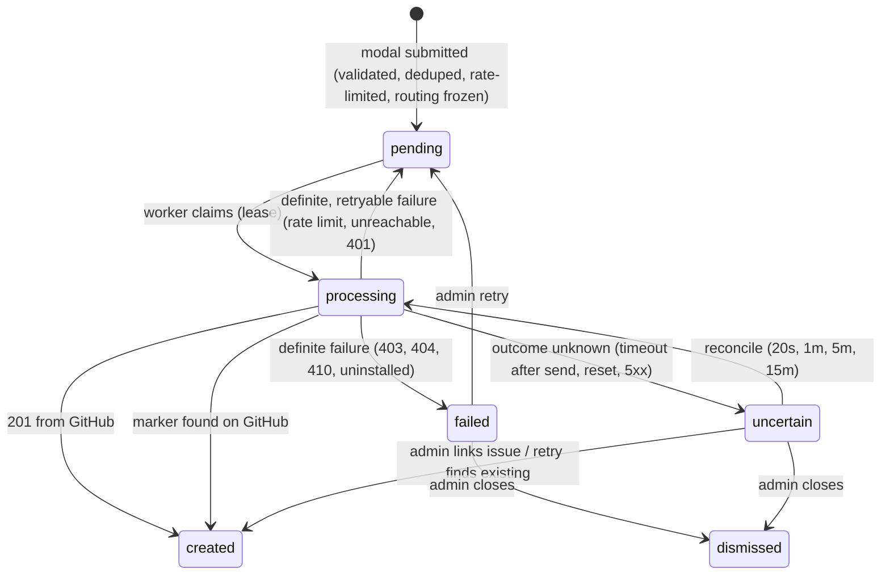

# Architecture

Internals of Ticket Relay: runtime, ticket lifecycle, endpoints, schema and security model.

## Runtime

Long-running Node.js processes sharing one SQLite database: a web process (admin console,
Discord endpoint, OAuth), one or more queue workers, and an optional triage worker.

```
                ┌───────────────────────────── ticket-relay ─────────────────────────────┐
 Discord ──────▶│ POST /discord/interactions   verify Ed25519 → accept → ack (≤3s)       │
                │                                       │                                 │
 Admins ───────▶│ Admin console (SSR, sessions, CSRF)   ▼                                 │
                │                               submissions (queue) ◀── worker ──────────┼──▶ GitHub REST
 GitHub ───────▶│ POST /github/webhook (optional)       │            create / retry /     │    (installation token)
                │                                       │            reconcile            │
                └───────────────────────────────────────┼─────────────────────────────────┘
                                                         ▼
                                                  SQLite (WAL)
```

- **AI triage, isolated from filing.** `src/triage/` runs in its own process. It picks up
  tickets that are already filed (`status = 'created'`, filed after triage was switched on),
  reads the ticket text from the GitHub issue, asks Claude (official SDK, structured JSON
  output) for priority, duplicate, regression, needs-info, several-problems, related,
  shared-across-apps, wrong-repository, spam and no-action calls plus the workspace's own label
  groups, and applies the actions each workspace allows. Results live in `triage_results`; the
  filing queue is never written. Bad keys, missing credits or an unavailable model pause triage
  for that workspace; rate limits and outages retry with backoff. Ticket text is passed as JSON
  data and Claude can only answer with fixed fields; every issue it names is checked against
  what it was shown, and labels, comments and closing come from the workspace settings.
  With its own switch, triage also covers issues opened directly on GitHub: the issue sync
  (polling, no webhooks) queues new ones in `issue_triage`, skipping pull requests, bots and
  issues this app filed. Each action has a separate mode for these issues (`githubModes`);
  labels, comments and closing are shared. Their results are reviewed in GitHub issues › Opened on GitHub and in AI triage › Review.
  Re-runs (`triage_runs`, `triage_run_items`) evaluate already-filed tickets and/or open GitHub issues with a saved copy
  of the settings: a preview never touches GitHub; applying it later (or an "apply" run) writes
  `triage_results` the way normal triage does, in bulk if asked (optionally approving the
  suggestions too). The worker only takes re-run items when no new ticket is waiting, one at a
  time, and a run waits instead of failing when Claude rate-limits it or when the
  installation's GitHub budget drops below a reserve (a fifth of the hourly limit, at least
  500 calls), so filing always has room. Every step is written to `triage_log` (kept 90 days), shown
  live in AI triage › Activity with the queues and what the worker is doing. Bulk Apply from
  the inbox or Opened on GitHub (`triage_bulk`) takes only the suggestions the list's filters are
  about and applies them one ticket at a time, with the same GitHub-budget guard.
  AI triage › Knowledge (`app_knowledge`): the triage worker also writes each app's TRIAGE.md
  with Claude (`src/triage/knowledge-writer.ts`), one app at a time after new tickets and issues,
  from the repository's README, changelog, docs and releases (read-only; private repositories need
  Contents: read) and the app's issues in the issue index (most reported open, recently fixed,
  closed as not planned), plus recent ticket summaries and the questions triage asked
  (`missing_context`, copied to `question`). Each ticket then gets its own app's TRIAGE.md as a
  second cached system block, as background facts (it comes from public text); the team's own
  notes and its answers to Claude's questions (`app_knowledge.team_answers`, saved from the app
  page's question tabs) stay separate, are never rewritten, and win. With Keep them up to date on, each app is
  looked at once the workspace's interval (`knowledgeEvery`: a number of minutes, hours or days,
  15 minutes to 90 days) has passed since its last update or look, and updated only if something
  changed since: issues opened or closed in its repository or questions Claude asked (a full
  rewrite), or only merged changes (an update, see below). A look that finds nothing new is noted
  (`auto_checked_at`), so the next one is an interval later; each app's card shows when it was
  last updated (in the viewer's time zone) and when it's looked at next.
  Each "Write all", "Update now" or scheduled update is a run (`knowledge_runs`; apps join the run
  in progress). While writing, the worker streams Claude's answer and saves the app's live state
  (`app_knowledge.auto_live`: steps and their times, log lines, the text so far, answers as they
  arrive) at most twice a second; each save also reads `auto_cancel`, so Stop aborts the request
  mid-stream and the app keeps its previous TRIAGE.md. Pages carry the Live studio while a run is on
  (and for two minutes after); app.js polls `/triage/knowledge/live`.
  While Keep them up to date is on, the worker's index loop also polls each app repository's
  default branch every 15 minutes (`src/triage/knowledge-changes.ts`,
  no webhooks; `repo_change_sync` keeps how far each one got, the first check reads 14 days back,
  and checks wait while the installation's hourly GitHub budget is low, keeping it for filing):
  merged pull requests, commits pushed without one (everything after the newest commit seen last
  time, whatever its date; not merges, squashed pull requests ending in "(#123)" or commits GitHub
  says a merged pull request brought in, rebased ones included) and releases go to
  `repo_changes`, and each app sharing the repository gets its own row in `app_changes`. Bots and
  chores (dependency bumps, CI, tests, refactors) are kept but marked and never sent to Claude.
  Each ticket's TRIAGE.md block gets the app's changes from the last 14 days right away, with
  dates rather than "2 days ago" so the cached prompt stays the same. An app with only changes
  waiting gets an update in "changes" mode (`app_knowledge.auto_mode`): Claude gets the current
  TRIAGE.md and the changes and returns it updated, saying for each change whether it added it or
  why not (`app_changes.status` and `note`). Issues and questions count from the last full write
  (`auto_full_at`). A full rewrite reads the 30 newest changes too, and afterwards nothing merged
  before it started is left waiting.
- **Repo status** (`src/repo-status/`, off by default per workspace in `repo_status_settings`):
  the worker's index loop reads at most one due repository per tick, stalest first, with GitHub's
  GraphQL API (its own hourly budget, separate from the REST one filing uses; reads wait while
  fewer than 300 points are left). A read is a handful of queries: releases with their asset
  downloads (checksums, signatures and updater files left out), the main one (counts, dates, each
  window's commit count as `history(since:)` aliases, the 100 newest and 30 most discussed open
  issues, the app icon's tree), the latest build's tag compared with the default branch
  (unreleased commits; an estimate when the tag isn't on it), commit authors, and PRs opened and
  merged and issues opened. Those last three lists are kept in `repo_status.raw` back to a horizon
  (the last week, or back to the latest build, at most 30 days) and only what's new since the last
  read is asked for, with a full read every 6 hours. Rows are per repository, shared by every
  workspace watching it (each watching workspace's shortest interval wins; Refresh makes everything
  read before it due again). Fix first scores open issues in `src/repo-status/score.ts` (ported
  from storytold/craft-repo-status-app): critical phrases +40, broken +15, a bug label +15, a
  user's report +10, reactions and comments up to +40, naming the latest build +10, fresh +8/+4, a
  request or docs −25, untouched for 30 days −5; a repository's urgency is its top five summed.
  Most reported (`src/repo-status/reports.ts`) reads only the database: each Discord ticket of the
  workspace that filed an issue counts for that issue, or for the original it copies (a duplicate
  triage applied, or `issue_index.duplicate_of`, followed up to five hops); a duplicate Claude
  suggested and nobody reviewed counts too, marked as suggested; spam doesn't count. Issues opened
  directly on GitHub as duplicates are counted apart.
- **Pull requests** (`pull_index`, `src/domain/pull-index.ts`): read from GitHub's pull request
  list for the issue index's repositories (the apps' ones), in the same loop but on their own: the
  issue list leaves pull requests out unless the app has Pull requests: Read, while a public
  repository's can be listed without it. A catch-up reads the open ones and the closed ones
  (`pulls_loaded_at`); then, every 10 minutes, only what changed since the newest one
  seen (`pulls_synced_until`, usually one call). A failure is kept in `pulls_error` (shown on Repo
  status › Pull requests) and never touches the issue sync; a failed catch-up is tried again two
  minutes later. Kept: open ones, merged ones for good, and ones closed without merging for 90 days (lists and triage look 90 days back), with the issues each says it fixes
  ("Fixes #12") or names ("for #12"); bots and chores are marked and left out. Each repository's
  releases are read every 30 minutes (`issue_index_repos.releases`), so a merged fix is "not
  released yet" or "in v1.4.3" (the first release published after the merge). With Being worked on or Already fixed
  on, triage (`src/triage/work.ts`) shows Claude the pull requests that name the issues the ticket
  matched, the best text matches among open and recently merged ones, and commits pushed without
  a pull request that close one of those issues (from Knowledge's change tracking); Claude answers
  `in_progress` and `fixed_by` with a ref it was shown, checked in `normalizeVerdict` (only an open
  one is in progress, only merged work fixed it). Repo status › Pull requests lists them.
- **Analytics** (`src/analytics/`, off by default per workspace in `analytics_settings`): GitHub
  only keeps each release file's running download total, so the worker's index loop reads every
  repository Repo status watches once per 30-minute slot (GraphQL: its releases and their files,
  and new stars) and keeps how much each file grew since the read before (`download_counts`, per
  slot; a short gap is spread evenly over its slots, a gap over a day starts recording again
  rather than inventing it; the first read is only a starting point, and a file that appears later
  counts from its release's publication). Files are classified by name (`assets.ts`: platform,
  architecture, format; checksums, signatures and update metadata aren't downloads). Detail is kept
  32 days, then added up per UTC day (`download_days`). Stars come with when each was given, so
  their history goes back to the first (`repo_stars`); the same read keeps GitHub's own star total
  per 30-minute slot (`repo_star_counts`, exact even when a star is taken back). The page buckets everything in the
  viewer's time zone (a `tr_tz` cookie app.js sets): ranges from today to 12 months, steps from 30
  minutes to a day (a step that would make over 400 buckets, or finer than a day beyond the 30-minute
  detail, isn't offered). Charts are drawn by app.js from the numbers on the page.
- **No Discord gateway.** The bot is driven entirely by Discord's HTTP interactions endpoint and
  REST API. It needs no privileged intents and no slash-command registration.
- **GitHub App auth.** Short-lived installation tokens are minted from the app's private key
  (RS256 JWT). Required permissions: `Issues: read & write`, `Metadata: read`; private repositories also need `Pull requests: read` and `Contents: read` (public ones' pull requests, commits, README and releases are readable without them). Contributor roles count merged pull requests from the pull request index, refreshed just before each check (GitHub's issue search leaves pull requests out without `Pull requests: read`, even in a public repository), and commits on each default branch; a repository whose pull requests couldn't be read yet makes a member who doesn't qualify try again later, rather than turning them down.
- **SQLite-backed queue.** Submissions are the jobs. Workers in any number of processes claim
  them with one atomic `UPDATE … RETURNING` under SQLite's write lock, plus a 90s lease.
  WAL mode and a busy timeout let processes share the file on one host.
- **Server-rendered admin UI.** No frontend build. A small progressive-enhancement script, a
  strict CSP, and no credentials in the browser. Icons are Lucide SVGs inlined from
  `src/web/icon-data.ts` (regenerate with `node scripts/build-icons.mjs`).

### Tenancy

- All data is scoped to a **workspace**: one GitHub App installation and one Discord server.
- A Discord server maps to exactly one workspace, because interactions are routed by `guild_id`.
  This is enforced by a unique constraint.
- People sign in with Discord OAuth and hold an `owner`, `admin` or `moderator` role per
  workspace. Moderators always see the tickets inbox; admins give each one *No access*, *View*
  or *Edit* page by page (one access map per moderator, `AREAS` in `src/domain/permissions.ts`).
  Routes need `manage` unless they opt in to a lower permission such as `inbox.edit` or
  `triage.prompt.view`. Non-members receive 404 on workspace routes.
- The console has four tools (Discord tickets `/tickets`, GitHub issues `/issues`, AI triage
  `/triage`, Contributor roles `/contributors`), each with one tab per page in `AREAS` order and a
  shared header (`src/web/routes/tool.ts`). A tool opens on the first page the person can see;
  pages they can't open show locked. Addresses from before (`/tickets/triage…`,
  `/tickets/issues…`) redirect: 301 for GET, 307 for forms.
- Workspace creation is limited to `PLATFORM_ADMIN_DISCORD_IDS`. If that list is empty, only the
  first user of a fresh deployment can create one. `OPEN_WORKSPACE_CREATION=true` lifts the limit.

## Ticket lifecycle



| Guarantee | Mechanism |
|---|---|
| Discord 3s deadline | Validation and persistence in one short transaction, then a deferred ephemeral response. GitHub work starts after the response is flushed. |
| Redelivery safety | `discord_interaction_id` is unique, so a repeated interaction is processed once. |
| Accidental duplicates | Keyed HMAC of normalized title and description per reporter and app, within a configurable window. |
| Concurrency | Accept runs in a `BEGIN IMMEDIATE` transaction (serialized across processes). Claims are atomic single-statement updates with leases. Writes are guarded by lease owner. |
| No blind retries | `github_request_started_at` is persisted before the create call. Unknown outcomes and crashed workers are reconciled by searching for the hidden marker `<!-- ticket-relay:submission=TR-… -->`, never by re-sending. |
| Stable routing | Repository, labels and installation are snapshotted at acceptance. Config changes never redirect queued tickets. |
| Label integrity | Labels are checked against the repository before creating, so GitHub never auto-creates them. A `422` triggers one retry without labels. |
| Retention | The description is dropped once the issue exists. Titles are purged after the workspace retention period (default 30d). Unresolved tickets keep their text for at least 90d. |

### Issue format

```
Title:  [App Name] Submitted title

### Description
<member's text, GitHub @-mentions neutralized>

### Ticket details
| App | Reported by | Submitted | Discord server | Submitted from channel | Submission ID |

<sub>Submitted through Discord by <member> and created by the Ticket Relay integration…</sub>
<!-- ticket-relay:submission=TR-7KQ2M9XA4D -->
```

The issue author is `<app-slug>[bot]`. The reporter's Discord display name, username and
stable user ID are recorded in the body.

## HTTP endpoints

| Route | Caller | Auth |
|---|---|---|
| `POST /discord/interactions` | Discord | Ed25519 signature, 5-minute timestamp window |
| `GET /oauth/discord/callback` | Browser | One-time state, bound to session (bot install) or nonce cookie (sign-in) |
| `GET /oauth/github/callback` | Browser | One-time state. Installation verified via `GET /user/installations`. |
| `POST /github/webhook` | GitHub | HMAC-SHA256 (`X-Hub-Signature-256`). 404 when no secret is configured. |
| `GET /healthz` | Load balancer | none (DB ping) |
| `/w/:workspaceId/*` | Owners, admins, moderators | Session cookie, workspace membership and role permission, CSRF on POST |

## Data model

| Table | Purpose |
|---|---|
| `workspaces` | Tenant root, with rate-limit, duplicate-window, retention and panel-copy settings |
| `users`, `workspace_members`, `workspace_invites` | Admin identities (Discord), roles, one-time invites |
| `sessions`, `oauth_states` | Hashed session tokens with CSRF token, and single-use OAuth state |
| `github_connections` | Installation ID, account and status per workspace |
| `discord_connections` | Guild (globally unique), tickets channel and status per workspace |
| `apps` | Member-facing name/description → repository ID and labels |
| `panels` | Published panel message ID, channel and content hash (detects stale or deleted panels) |
| `submissions` | Tickets, routing snapshot, queue state, lease, reconcile counters, encrypted payload |
| `submission_events` | Append-only timeline for investigation |
| `contributor_settings`, `contributor_panels`, `contributor_tiers` | On/off, panel channel, published panel, and role tiers (role + minimum contributions) per workspace |
| `analytics_settings`, `download_assets`, `download_counts`, `download_days`, `download_sync`, `repo_stars`, `repo_star_counts` | Analytics: on/off; each release file and its total; downloads per 30 minutes (then per day); per repository, when recording began and the last slot read; stars with when each was given; star totals per 30 minutes |
| `pull_index` | Pull requests of the indexed repositories (open, and closed for 90 days), with the issues each is for |
| `repo_status_settings`, `repo_status` | Repo status: on/off, the repositories and how often per workspace; what was last read per repository (stats, the kept activity, the icon, the error and the GraphQL budget left) |
| `contributor_links`, `contributor_verifications` | One GitHub account ↔ one Discord member per workspace; audit trail of every verification |

Migrations live in [`src/db/migrations`](../src/db/migrations) and are applied inside one write
transaction, so concurrent boots are safe. Storage conventions: UUID text IDs, epoch-ms
`*_at` columns, JSON text for arrays and objects.

## Security

- **Secrets:** server-side only. Provider credentials come from env. Stored tokens and ticket
  text are encrypted at rest. Session tokens are stored hashed.
- **Inbound verification:** Discord Ed25519 signatures, GitHub webhook HMAC, single-use OAuth
  state bound to the browser session.
- **Ownership checks:** the Discord guild is taken from the OAuth token response, not redirect
  parameters. The GitHub installation must appear in the authorizing user's installations.
- **Server-side allowlists:** repositories are restricted to the workspace installation (Issues
  enabled, not archived). Labels must exist. Channels must belong to the connected guild and
  pass a permission check.
- **Output safety:** `allowed_mentions: { parse: [] }` on all Discord messages, Discord
  markdown escaped in echoes, GitHub @-mentions neutralized in issue bodies.
- **Web hardening:** strict CSP with no inline script or style, `frame-ancestors 'none'`,
  `Referrer-Policy: same-origin`, `SameSite=Lax` and `HttpOnly` cookies (`Secure` on HTTPS).
- **Logging:** structured JSON. Query strings, auth headers and cookies are stripped, and
  ticket text is never logged.
- **Error exposure:** members see generic messages. Provider error details are shown only to
  workspace admins.
